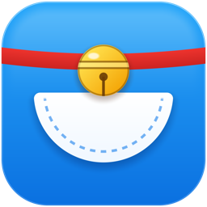
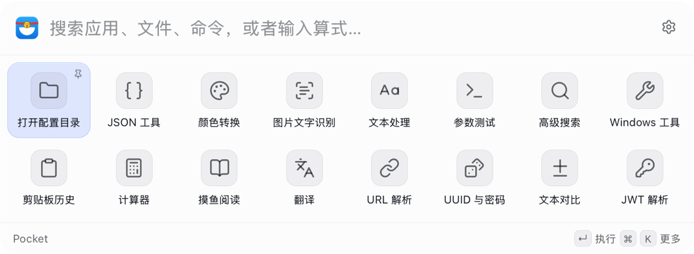
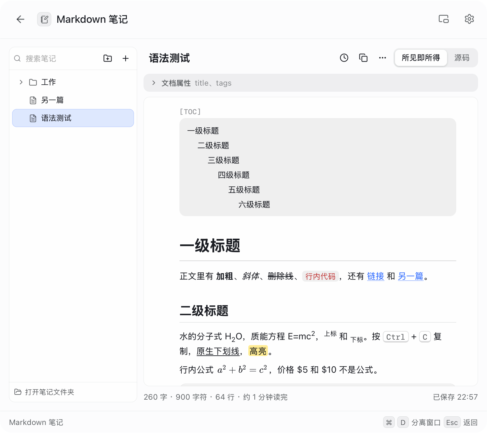
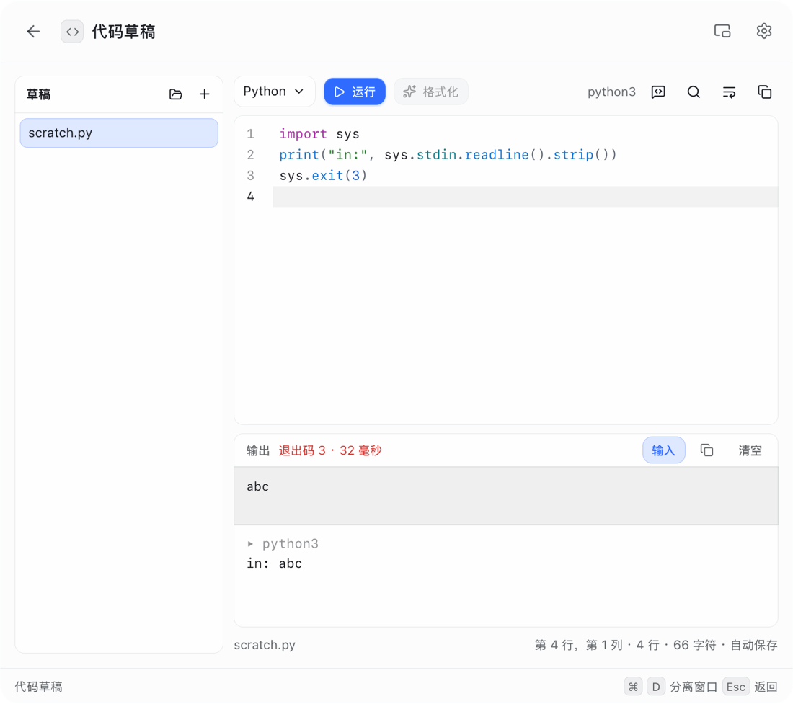
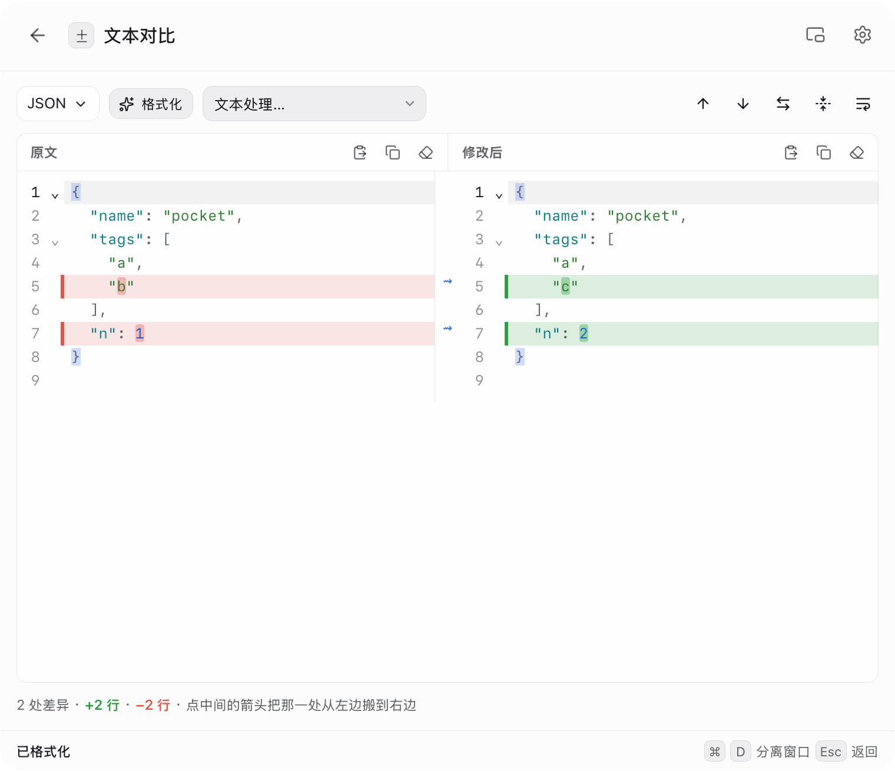
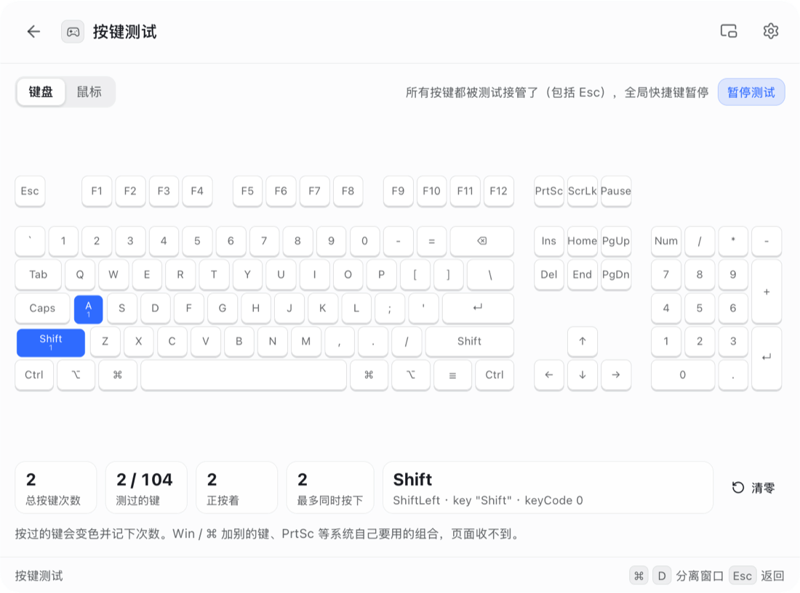

<div align="center">



# Yojigen Pocket

**四次元口袋：一个键唤出，要用的东西都在里面。**

一个开源的桌面启动器和工具箱，macOS 和 Windows 都能用。<br>
Go 写的，没有 Electron：Windows 安装包不到 10 MB，macOS 的通用安装包 17 MB。

[](https://github.com/mytlx/yojigen-pocket/releases)
[](https://github.com/mytlx/yojigen-pocket/actions/workflows/build.yml)
[](LICENSE)


[下载](#下载) · [功能](#里面有什么) · [使用手册](docs/guide.md) · [自己扩展](#自己扩展) · [参与开发](#参与开发)



</div>

## 为什么做这个

uTools 很好用，但有些东西我想自己说了算：数据放在哪、界面长什么样、缺的工具能不能自己加。
所以有了这个项目。它做的事情和 uTools、Raycast、Alfred 是一类：按 `Alt + Space` 唤出一个搜索框，
找应用、找文件、算个数、翻一下剪贴板，或者打开一个小工具把手头的事做完。

几个一开始就定下的原则：

- **数据都在本地。** 配置、剪贴板历史、笔记都是用户目录下的普通文件，可以自己备份和同步。API 密钥存在系统钥匙串里，不进配置文件。
- **不用就不占资源。** 核心只有启动器和一批小工具。笔记、代码编辑器、桌面宠物这些大块头是[扩展包](docs/extensions.md)，装了才有，停用之后连进程和窗口都不留。
- **能改。** 脚本、扩展、主题样式都是往文件夹里放文件，改完立刻生效，不用重启。

## 里面有什么

**找东西**

- 应用：支持拼音全拼和首字母，`wx`、`weixin`、`微信` 都能找到微信；会记住你常开的
- 文件：macOS 用聚焦，Windows 用 Everything；带类型筛选、预览和属性的「高级搜索」
- 剪贴板历史：文字、图片、文件，可以固定和搜索
- 网页搜索、系统操作（锁屏、睡眠、清空回收站……）、Windows 的控制面板项和管理工具

**随手处理**

- 计算器：单位和进制换算、多行计算、变量、历史
- 翻译：Claude、兼容 OpenAI 的接口、有道、百度；带发音（单词用词典发音，句子用 Edge 语音）
- 截图识别文字：系统自带的离线识别，或大模型识别
- 摸鱼阅读：txt / epub，有个不起眼的小窗模式

**开发常用**

- JSON、编码转换、哈希、时间戳、正则、JWT、UUID、颜色、URL 解析、文本处理

**其他**

- 鼠标连点器、键盘宏、键盘和鼠标按键测试

**扩展包**（单独下载，在“道具库 → 扩展管理”里安装）

- 写作与代码：Markdown 笔记（所见即所得，也能切到源码）、代码草稿（27 种语言高亮和格式化，装了环境的直接运行）、文本对比（两边直接改，差异实时标出来）
- 桌面宠物：一只可以养的 3D 小狸猫

所有功能页都可以拆成独立窗口，也都可以绑一个全局快捷键。完整的清单和用法在[使用手册](docs/guide.md)里。

<table>
  <tr>
    <td></td>
    <td></td>
  </tr>
  <tr>
    <td align="center">Markdown 笔记</td>
    <td align="center">代码草稿：写完直接运行</td>
  </tr>
  <tr>
    <td></td>
    <td></td>
  </tr>
  <tr>
    <td align="center">文本对比</td>
    <td align="center">按键测试</td>
  </tr>
</table>

## 下载

到 [Releases](https://github.com/mytlx/yojigen-pocket/releases) 下载最新版本：

| 系统 | 文件 |
| --- | --- |
| macOS 13 及以上（Intel 和 Apple 芯片通用） | `yojigen-pocket-x.y.z.dmg` |
| Windows 10 / 11（x64） | `yojigen-pocket-setup-x.y.z-amd64.exe`，或免安装的 `…-windows-amd64-portable.zip` |
| Windows 11（ARM） | `yojigen-pocket-setup-x.y.z-arm64.exe` |
| 扩展包（两个系统通用，按需下载） | `editors-x.y.z.zip`（笔记、代码草稿、文本对比）、`pet-x.y.z.zip`（桌面宠物） |

> **macOS 提示“无法打开”或“已损坏”？** 安装包没有苹果的开发者签名。把应用拖进“应用程序”后，在终端里运行一次：
>
> ```bash
> xattr -dr com.apple.quarantine "/Applications/Yojigen Pocket.app"
> ```

Windows 上界面用的是系统自带的 WebView2，Windows 11 和更新过的 Windows 10 都已经有了。

## 上手

装好之后按 `Alt + Space`（macOS 是 `⌥ Space`）。被别的程序占了的话会自动换成 `Alt + Shift + Space`，可以在设置里改。

| 输入 | 得到 |
| --- | --- |
| `wx` | 打开微信 |
| `1+2*3`、`10 km to mi` | 算出结果，回车复制 |
| `f 报告` | 搜文件 |
| `cb ` | 翻剪贴板历史 |
| `fy hello` | 翻译 |
| `md5 hello` | 回车直接复制结果；`Ctrl + 回车` 打开哈希工具 |
| `md`、`scratch`、`diff` | 笔记、代码草稿、文本对比（装了“写作与代码”扩展包之后） |
| `> ls -la` | 运行一条命令 |

选中一段文字再唤出，文字会变成搜索框里的一个块，接着输入 `翻译`、`md5` 就是在处理它。
`⌘K` / `Ctrl + K` 看当前这一项还能做什么，`⌘D` / `Ctrl + D` 把功能页拆成独立窗口。

## 自己扩展

- **脚本命令**：往 `commands` 文件夹里放一个脚本（Shell、Python、PowerShell、JS……），开头写几行注释声明标题和关键词，它就是一条命令。输出可以是通知、列表、文本或 Markdown。
- **扩展**：一个文件夹加一个 `plugin.json`，页面跑在隔离的 iframe 里，通过 `window.pocket` 调用宿主的能力（文件、网络请求、运行代码、悬浮窗……），还可以带一个按需启动的本地程序。一个扩展能带多个工具，打成 zip 就能分享。见[扩展文档](docs/extensions.md)。
- **外观**：`ui/theme.css` 改颜色和圆角，`ui/user.css`、`ui/user.js` 想怎么改怎么改。

写法和接口见[使用手册的“自定义”一节](docs/guide.md#自定义)。

## 参与开发

需要 [Go](https://go.dev/dl/) 1.27 以上和 [Bun](https://bun.sh)。

```bash
git clone https://github.com/mytlx/yojigen-pocket.git
cd yojigen-pocket
bun install
bun run dev
```

开发版用单独的用户目录（`~/.yojigen-pocket-dev`），可以和正式版同时开着。

```bash
go test ./...        # 单元测试
tools/e2e/run.sh     # 端到端测试：启动真实的应用跑一遍（目前只在 macOS 上跑过）
bunx mygo build      # 打包
```

技术上是 Go 后端加网页前端：

| 部分 | 用的什么 |
| --- | --- |
| 桌面框架 | [mygo](https://github.com/egoist/mygo)：纯 Go，不需要 cgo，用系统自带的 WebView |
| 界面 | Preact + TypeScript + Vite |
| 编辑器 | CodeMirror 6、Milkdown（在“写作与代码”扩展包里） |
| 3D | three.js（在“桌面宠物”扩展包里） |

代码结构、打包和 CI 的细节在[使用手册的“开发”一节](docs/guide.md#开发)。

欢迎提 issue 和 PR。改动比较大的话，先开个 issue 说一下想法，免得白做。

## 致谢

- [uTools](https://u.tools)、[Raycast](https://www.raycast.com)、[Alfred](https://www.alfredapp.com)：这类工具该是什么样，是它们教的
- [mygo](https://github.com/egoist/mygo)：让 Go 写桌面应用这件事变得很轻
- [edge-tts](https://github.com/rany2/edge-tts)：Edge 语音的接口参数和签名算法参照了它的实现

## 许可证

[MIT](LICENSE)
